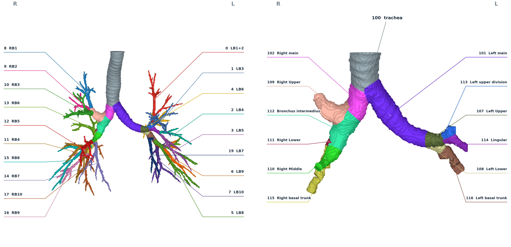

# Track 3 Label Guide

The task uses **32 classes: 13 proximal airway classes and 19 segmental classes**. L/R indicate the patient's left/right sides. IDs are the values used in predictions.

## Proximal airways

| ID | Label | Meaning |
| --- | --- | --- |
| 100 | trachea | Trachea |
| 101 | Left main | Left main bronchus |
| 102 | Right main | Right main bronchus |
| 107 | Left Upper | Left upper lobar bronchus |
| 108 | Left Lower | Left lower lobar bronchus |
| 109 | Right Upper | Right upper lobar bronchus |
| 110 | Right Middle | Right middle lobar bronchus |
| 111 | Right Lower | Right lower lobar bronchus |
| 112 | Bronchus intermedius | Right intermediate bronchus |
| 113 | Left upper division | Left upper division bronchus |
| 114 | Lingular | Lingular bronchus |
| 115 | Right basal trunk | Right basal trunk |
| 116 | Left basal trunk | Left basal trunk |

## Segmental bronchi

| ID | Label | Meaning |
| --- | --- | --- |
| 0 | LB1+2 | Left apicoposterior segment |
| 1 | LB3 | Left anterior segment |
| 2 | LB4 | Left superior lingular segment |
| 3 | LB5 | Left inferior lingular segment |
| 4 | LB6 | Left superior segment (lower lobe) |
| 5 | LB8 | Left anterior basal segment |
| 6 | LB9 | Left lateral basal segment |
| 7 | LB10 | Left posterior basal segment |
| 8 | RB1 | Right apical segment |
| 9 | RB2 | Right posterior segment |
| 10 | RB3 | Right anterior segment |
| 11 | RB4 | Right lateral segment (middle lobe) |
| 12 | RB5 | Right medial segment (middle lobe) |
| 13 | RB6 | Right superior segment (lower lobe) |
| 14 | RB7 | Right medial basal segment |
| 15 | RB8 | Right anterior basal segment |
| 16 | RB9 | Right lateral basal segment |
| 17 | RB10 | Right posterior basal segment |
| 19 | LB7 | Left medial basal segment |

**A segment label represents the union of all annotated branches belonging to that segment, not just one centerline.** LB1+2 is one class. ID 0 is a valid label, not background; ID 18 is unused.

**Anatomical variation may result in missing labels in individual cases, but does not introduce new label classes.** A case need not contain all 32 classes; additional daughter branches within a segment retain its existing label. The complete ID mapping is available in [assets/label_schema.json](./assets/label_schema.json).
